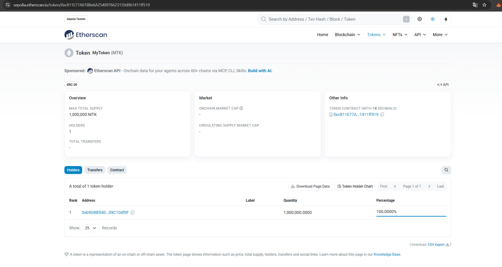

# MyToken (MTK)

ERC20 token built with Hardhat and OpenZeppelin Contracts v5.

- **Name / symbol:** MyToken / MTK, 18 decimals
- **Initial supply:** 1,000,000 MTK, minted to the deployer
- **Owner minting:** `mint(to, amount)` is restricted to the owner (OpenZeppelin `Ownable`)
- **Transfers:** standard ERC20 `transfer`, `approve`, `transferFrom`

## Deployed contract

| | |
|---|---|
| Network | Sepolia testnet |
| Contract | https://sepolia.etherscan.io/address/0xc811E77A018Be6A2540976623159d961411ff519 |
| Deployment transaction | https://sepolia.etherscan.io/tx/0xf828de272bbdfb0b83be45e3e1f2df03c218f9ac59a5c3c47d9c7bbe9b241c14 |



## Project structure

```
contracts/MyToken.sol   ERC20 token contract
scripts/deploy.js       deployment script
test/MyToken.js         tests for minting, transfers and balances
hardhat.config.js       networks: hardhat, localhost, testnet
```

## Run it

```bash
npm install
npx hardhat compile
npx hardhat test
```

### Deploy to a local Hardhat network

Terminal 1:

```bash
npx hardhat node
```

Terminal 2:

```bash
npx hardhat run scripts/deploy.js --network localhost
```

### Deploy to Sepolia

Store the private key of a test account (it is saved outside the project, never committed):

```bash
npx hardhat vars set TESTNET_PRIVATE_KEY
npx hardhat run scripts/deploy.js --network testnet
```

## Tests

| Area | What is checked |
|---|---|
| Deployment | initial supply and deployer balance; name, symbol, decimals; owner |
| Minting | owner can mint (balance, total supply, `Transfer` event); non-owner is rejected; no minting to the zero address |
| Transfers | transfers between accounts; sending more than the balance fails; balances unchanged after a failed transfer; no transfers to the zero address; `approve` / `transferFrom` within and beyond the allowance |

## Note on ethers versions

The assignment's sample code uses ethers v5 (`ethers.utils.parseEther`, `deployed()`, `.address`).
Current Hardhat uses ethers v6, so the code here uses the v6 equivalents:
`ethers.parseEther`, `waitForDeployment()` and `getAddress()`.
